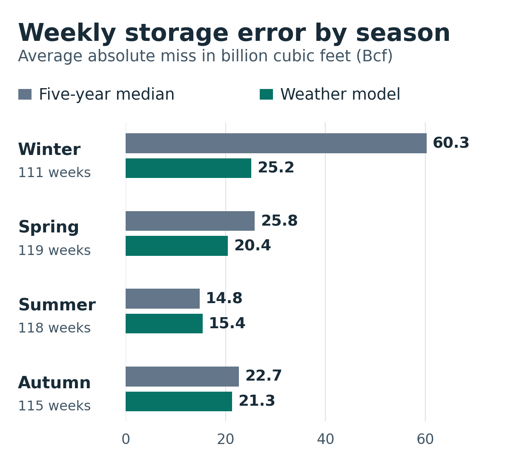

# John Barreto | U.S. natural gas research

I study how weather changes the amount of gas in U.S. storage, how Henry Hub prices differ by delivery month, and what those differences mean for an industrial gas buyer.

## Featured project · Natural Gas Pattern Lab

What happened to Henry Hub the last time the same conditions appeared? I built the Pattern Lab to find those dates and compare what followed. On seven dates, U.S. gas storage was below its five-year average, forecast heating degree days rose and forecast cooling degree days held steady. Five spot-price observations later, Henry Hub was higher in four cases and lower in three.

[Explore the matched dates](https://neurax-jb.github.io/Henry-Hub-Futures-Curve-Explorer-How-the-Natural-Gas-Market-prices-winter/lab/patterns/) · [Open the code and data](https://github.com/NeuraX-JB/natural-gas-pattern-lab)

## Natural Gas Field Studies · Ten-book series

I directed this series on U.S. natural gas, from storage and industrial demand to Henry Hub futures. AI tools conducted the analyses and prepared the books and research companions. In Book 10, the front-month chart and the incoming contract moved in opposite directions on 57 of 235 verified handoffs.

[Browse all ten books and research files](https://github.com/NeuraX-JB/natural-gas-research-notes/tree/main/field-studies) · [Open the reading edition](https://neurax-jb.github.io/natural-gas-research-notes/field-studies/)

## When does weather improve a storage estimate?

Across 463 weeks, adding observed U.S. weather to a five-year seasonal median cut the average absolute miss on weekly Lower 48 storage changes from **30.50 to 20.50 billion cubic feet (Bcf)**. Most of the gain came in winter. In summer the seasonal median came closer on average.

This is a historical replay using observations available in the November 2026 data edition. Some inputs may have been revised since the original release. The separate forecast ledger had **zero completed live forecasts** on 23 November 2026.

Weeks are grouped by the month of the storage Friday, with December through February counted as winter. The sample runs from 5 January 2018 through 13 November 2026 and includes partial seasons at both ends.

[Read the storage study](https://neurax-jb.github.io/natural-gas-research-notes/lab/research/storage-weather.html) · [Inspect the 463 weekly results](https://github.com/NeuraX-JB/henry-hub-storage-forecaster/blob/30148e34f458c2caa057ce36472e3a457f04064f/lab/storage/backtest.csv) · [Open the storage dashboard](https://neurax-jb.github.io/henry-hub-storage-forecaster/lab/storage/) · [Storage code and instructions](https://github.com/NeuraX-JB/henry-hub-storage-forecaster)

## More comparisons to explore

- **Weather revisions.** Two NOAA runs barely changed the national heating outlook for 22–29 November 2026, while Idaho lost nearly 22 heating degree days over those same dates. [Replay Idaho and compare it with the U.S.](https://neurax-jb.github.io/natural-gas-weather-monitor/lab/weather/?earlier=2026-11-20T00:00:00Z&later=2026-11-21T00:00:00Z&metric=hdd&region=ID) · [Weather code](https://github.com/NeuraX-JB/natural-gas-weather-monitor)
- **Futures curves.** Between June and September 2026, January 2027 gas fell about $0.64 per million Btu. July 2027 fell $0.16. Both prices are reconstructed from fund holdings. [Compare the same nine delivery months](https://neurax-jb.github.io/henry-hub-futures-curve/?data=strips&view=curve&a=2026-06-30&b=2026-09-30&align=delivery) · [Curve code](https://github.com/NeuraX-JB/henry-hub-futures-curve)
- **Industrial gas costs.** An illustrative paper mill would have spent $17,231 less in the 2025–26 winter replay when it fixed half its monthly gas use. January alone saved more than the winter total. [Change the mill’s assumptions](https://neurax-jb.github.io/industrial-gas-cost-simulator/lab/industrial/) · [Cost calculations](https://github.com/NeuraX-JB/industrial-gas-cost-simulator)

## Publications and data

[Read the two research notes](https://neurax-jb.github.io/natural-gas-research-notes/) or [inspect their sources](https://github.com/NeuraX-JB/natural-gas-research-notes). To work with the underlying series, [explore the weekly storage, weather and spot-price data](https://neurax-jb.github.io/natural-gas-data-api/lab/api/) or [open the API repository](https://github.com/NeuraX-JB/natural-gas-data-api).

The project links above open fixed research editions. The [Henry Hub Research Lab](https://neurax-jb.github.io/Henry-Hub-Futures-Curve-Explorer-How-the-Natural-Gas-Market-prices-winter/lab/) hosts the refresh workflow and the [dated storage forecast ledger](https://github.com/NeuraX-JB/Henry-Hub-Futures-Curve-Explorer-How-the-Natural-Gas-Market-prices-winter/tree/main/lab/storage/ledger).
